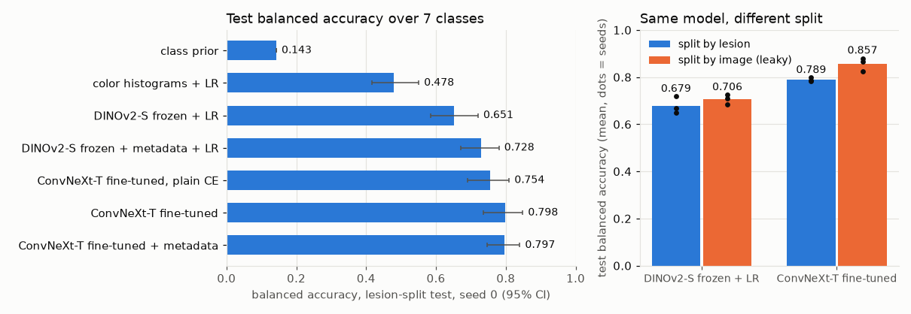
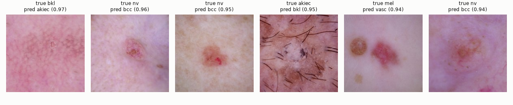

# ham10000-lesion-split

[](https://github.com/alexanderbasalgin/ham10000-lesion-split/actions/workflows/tests.yml)

Classifies dermoscopic images of skin lesions into 7 diagnoses (HAM10000), and measures how much a naive per-image split overstates the result.



Left: every model on the same held-out test set (1408 images of 1067 lesions that never appear in train or val), with 95% bootstrap CIs that resample whole lesions. Right: the two strongest model types trained and tested on the lesion-level split vs a random per-image split, over 3 split seeds.

## Results

Test set: split seed 0, grouped by `lesion_id` and stratified by class, 72/14/14 train/val/test. Hyperparameters and the best epoch are picked on val only. Balanced accuracy is the mean per-class recall, so "always predict nevus" (69% of images) gets 1/7.

| model | balanced acc. (95% CI) | macro F1 | accuracy | melanoma recall | melanoma sens. @ 90% spec. | malignant vs benign AUC |
|---|---|---|---|---|---|---|
| class prior (always `nv`) | 0.143 | 0.117 | 0.691 | 0.00 | - | 0.500 |
| HSV color histograms + logistic regression | 0.478 (0.42-0.55) | 0.318 | 0.509 | 0.53 | 0.36 | 0.790 |
| DINOv2 ViT-S/14 frozen + logistic regression | 0.651 (0.59-0.72) | 0.535 | 0.701 | 0.49 | 0.45 | 0.868 |
| same + age/sex/body site | 0.728 (0.67-0.78) | 0.599 | 0.732 | 0.60 | 0.52 | 0.886 |
| ConvNeXt-T fine-tuned, plain cross-entropy | 0.754 (0.69-0.81) | 0.743 | 0.864 | 0.57 | 0.79 | 0.912 |
| **ConvNeXt-T fine-tuned, class-weighted CE** | **0.798 (0.74-0.85)** | 0.745 | 0.828 | 0.64 | 0.75 | 0.915 |
| same + age/sex/body site branch | 0.797 (0.75-0.84) | 0.728 | 0.834 | 0.62 | 0.75 | 0.922 |
| same, 320 px input instead of 224 | 0.772 (0.70-0.83) | 0.749 | 0.865 | 0.55 | 0.75 | 0.900 |

Mean ± std over 3 split seeds (different train/val/test partitions, different training seeds):

| model | split | balanced acc. | accuracy | melanoma sens. @ 90% spec. |
|---|---|---|---|---|
| DINOv2-S frozen + LR | by lesion | 0.679 ± 0.028 | 0.716 ± 0.011 | 0.49 ± 0.03 |
| DINOv2-S frozen + LR | by image (leaky) | 0.706 ± 0.017 | 0.722 ± 0.006 | 0.50 ± 0.03 |
| DINOv2-S frozen + meta + LR | by lesion | 0.713 ± 0.018 | 0.739 ± 0.005 | 0.51 ± 0.01 |
| ConvNeXt-T fine-tuned | by lesion | **0.789 ± 0.007** | 0.817 ± 0.011 | 0.73 ± 0.03 |
| ConvNeXt-T fine-tuned | by image (leaky) | 0.857 ± 0.023 | 0.904 ± 0.010 | 0.90 ± 0.03 |
| ConvNeXt-T fine-tuned + meta | by lesion | 0.771 ± 0.019 | 0.849 ± 0.020 | 0.74 ± 0.02 |

Full tables: [reports/results.md](reports/results.md), raw metrics in `reports/main_run/` and `reports/repeats/`.

What the numbers say:

- **Fine-tuning beats a frozen foundation model by a wide margin.** DINOv2 features with a linear head reach 0.68 balanced accuracy; fine-tuning a smaller ImageNet-22k ConvNeXt-T end to end gets 0.79. The gap is largest on melanoma (sensitivity at 90% specificity 0.49 vs 0.73).
- **A per-image split inflates the fine-tuned model by about 7 points of balanced accuracy and 17 points of melanoma sensitivity.** About 35% of test images in a random split have a sibling photo of the same lesion in train. On those images the fine-tuned model's class-balanced recall is 0.92, on the rest 0.82-0.84 (split seeds 1 and 2). The frozen DINOv2 probe barely benefits (+0.03): a linear head on generic features cannot memorise individual lesions, a fine-tuned network can.
- **Patient metadata helps the weak model, not the strong one.** Age, sex and body site add 3-8 points to the linear probe but nothing (or slightly less, 0.771 vs 0.789 over 3 seeds) to the fine-tuned ConvNeXt, whose validation curve with the metadata branch peaks early and then drifts down.
- **Class weighting is a trade, not a free win.** Weighting CE by inverse sqrt frequency raises balanced accuracy from 0.754 to 0.798 and melanoma recall at the argmax from 0.57 to 0.64, at the cost of overall accuracy (0.864 -> 0.828) because more nevi get flagged.
- **320 px input did not help** (0.772 vs 0.798 on the same split) at twice the training time.

Training ran on a single Kaggle T4: the first round (all models, split seed 0) took 44 minutes, about 10 minutes per ConvNeXt fine-tune; the second round (two more split seeds, 320 px run) took 84 minutes.

## Where it fails



Most confident mistakes of the ConvNeXt model on the lesion-split test set (one image per lesion):

| image | true | predicted (confidence) | notes |
|---|---|---|---|
| ISIC_0026326, male 30, face | nevus | basal cell carcinoma (0.97) | pink, raised lesion with visible vessels |
| ISIC_0034203, female 40, back | nevus | basal cell carcinoma (0.94) | all 3 photos of this lesion get the same wrong answer |
| ISIC_0024707, male 60, face | actinic keratosis | benign keratosis (0.93) | scaly surface, no pigment network |

Patterns behind the errors:

- **Pink, non-pigmented nevi are read as BCC.** The model has learned "red with vessels = BCC", which is right most of the time; 23 of 973 test nevi go to BCC or akiec, and 11 of those to BCC.
- **akiec vs bkl is the hardest pair** (23% of akiec predicted as bkl, see `reports/figures/confusion.png`). Both are scaly keratinising lesions on sun-damaged skin of older people and are hard to separate in dermoscopy for dermatologists too.
- **Melanoma vs nevus**: 16% of melanomas are called nevi, the most costly error. A deployment would need a lower melanoma threshold than argmax; at 90% specificity the model catches 73% of melanomas.
- **The headline accuracy is flattered by an easy subgroup.** HAM10000 labels come from histology (739 test images), follow-up (519), expert consensus (142) and confocal (8). Follow-up images are nevi photographed over time at one clinic and the model gets 99.4% of them right; on histology-confirmed images the error rate is 30% and balanced accuracy is 0.746. The histology subset is the one that resembles a real referral setting.

## Data

[HAM10000](https://doi.org/10.1038/sdata.2018.161) (Tschandl et al., 2018, CC BY-NC 4.0): 10015 dermoscopic images of 7470 lesions, 7 classes, very imbalanced (nevi 67%, dermatofibroma 1.1%), with age, sex and body site. The full run uses the Kaggle copy `kmader/skin-cancer-mnist-ham10000`; `scripts/fetch_sample.py` pulls ~300 images through the Hugging Face mirror for local smoke tests. The three images in `examples/` are from the test split of seed 0.

Images are center-cropped from 600x450 to a square and cached at 256 px.

## Approach

- `skinlesion/data.py` - loading, label normalisation, lesion-level (`StratifiedGroupKFold`) and per-image splits, metadata encoding.
- `skinlesion/baselines.py` - class prior; 36 HSV histogram and center-vs-border color features with logistic regression.
- `skinlesion/model.py` - `SkinNet`: timm backbone, optional MLP over age/sex/site concatenated to the pooled features; frozen feature extraction for the DINOv2 probe.
- `skinlesion/train.py` - fine-tuning: AdamW (backbone 2e-4, head 1e-3), 1 epoch warmup + cosine, 15 epochs, batch 48, AMP, label smoothing 0.05, class weights `(N/n_c)^0.5`; augmentations are random resized crop, flips, 90 degree rotations and mild color jitter. Checkpoint = epoch with the best val balanced accuracy. Test predictions average 4 flip views.
- `skinlesion/experiments.py` - runs everything and writes metrics, test predictions and thumbnails.
- `skinlesion/metrics.py` - balanced accuracy, macro F1, per-class recall, melanoma sensitivity at fixed specificity, lesion-level bootstrap CIs.
- `app/main.py` - FastAPI service around the model.

## How to run

```bash
python -m venv .venv && source .venv/bin/activate
pip install -r requirements.txt          # CPU torch
python -m pytest -q                      # fast tests on synthetic images, no downloads

# fetch ~300 images and run the whole pipeline with tiny models on CPU (~2 min)
python scripts/fetch_sample.py --out data/sample --n 300
DATA_ROOT=data/sample OUTPUT_DIR=artifacts/quick QUICK=1 python kaggle/train.py
```

Full training (any machine with a GPU, ~45 min on a T4 for the first round, ~85 min for the repeats):

```bash
# download kmader/skin-cancer-mnist-ham10000 from Kaggle into data/ham10000, then
STAGE=main    DATA_ROOT=data/ham10000 OUTPUT_DIR=artifacts/run     python kaggle/train.py
STAGE=repeats DATA_ROOT=data/ham10000 OUTPUT_DIR=artifacts/repeats python kaggle/train.py
python scripts/make_report.py artifacts/run --repeats artifacts/repeats/metrics_repeats.json
cp artifacts/run/finetune.pt artifacts/
```

The same commands are wrapped in the `Makefile` (`make test`, `make quick`, `make train`). On Kaggle the same `kaggle/train.py` is the notebook entry point with the dataset attached; it finds the data under `/kaggle/input` by itself.

### Predict one image

Needs `artifacts/finetune.pt` (55 MB, fp16) from the training run. Age, sex and site are only used by the metadata model and are ignored otherwise.

```
$ python -m skinlesion.predict examples/nv_ISIC_0031355.jpg --age 55 --sex female --site trunk
{"prediction": "nv", "prediction_name": "melanocytic nevus", "malignant_probability": 0.0901,
 "probabilities": {"nv": 0.7906, "vasc": 0.0582, "df": 0.0479, "akiec": 0.0356, "bcc": 0.028, "mel": 0.0265, "bkl": 0.0132}}

$ python -m skinlesion.predict examples/bcc_ISIC_0034093.jpg
{"prediction": "bcc", "prediction_name": "basal cell carcinoma", "malignant_probability": 0.9582,
 "probabilities": {"bcc": 0.9, "mel": 0.045, "df": 0.0143, "akiec": 0.0133, "vasc": 0.0129, "bkl": 0.0077, "nv": 0.0068}}

$ python -m skinlesion.predict examples/akiec_ISIC_0024707.jpg --age 60
{"prediction": "bkl", "prediction_name": "benign keratosis", "malignant_probability": 0.0317,
 "probabilities": {"bkl": 0.9381, "df": 0.0147, "bcc": 0.0146, "vasc": 0.0135, "akiec": 0.0128, "mel": 0.0043, "nv": 0.002}}
```

The last one is wrong (true label: actinic keratosis), see above. The `bcc` example is a 192 px thumbnail, the other two are the original 600x450 images.

### Serve

```bash
docker build -t ham10000-lesion-split .          # expects artifacts/finetune.pt
docker run -p 8000:8000 ham10000-lesion-split
curl -F image=@examples/bcc_ISIC_0034093.jpg -F age=80 -F site=face localhost:8000/predict
```

Bad input gets a 4xx: a file that is not an image returns 400, an unknown body site or out-of-range age returns 422.

## What did not work

- Metadata fusion in the fine-tuned model, see above. A late fusion (separate tabular model stacked on CNN probabilities) might behave better than concatenating features inside the network.
- Higher resolution (320 px) gave no gain on this split.
- The "seen vs unseen lesion" accuracy in the random split is confounded by class: 88% of lesions with several photos are histology-confirmed (vs 25% of single-photo ones) and 20% are melanomas (vs 4%), so their raw accuracy is lower even though the model memorises them. The class-balanced recall on seen vs unseen lesions is the fairer comparison and is what is quoted above.

## Next steps

- Evaluate on an external set (ISIC 2019 or the official HAM10000 test set) to check how much of the score survives a different clinic and camera.
- Threshold tuning per class on val for a fixed melanoma sensitivity, and calibration (temperature scaling) before reporting probabilities.
- Ensembling the 3 split-seed models, and stronger backbones (EfficientNetV2, ConvNeXt-S) with longer schedules.

Not a medical device; for research and learning only.
